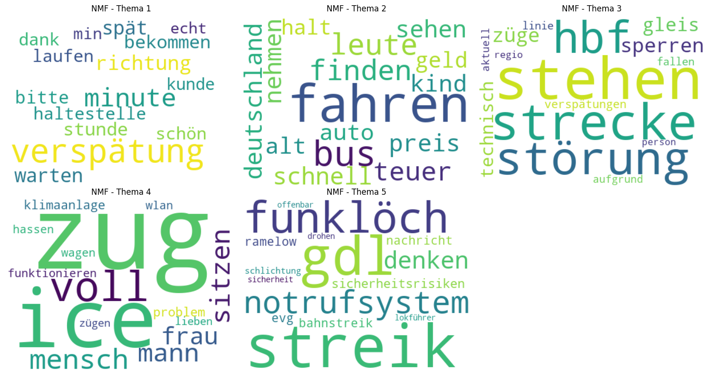

# NLP-Themenanalyse von Beschwerdetexten

Dieses Projekt untersucht mit NLP-Methoden in Python, worüber sich Bahnkundinnen und -kunden am häufigsten beschweren. Grundlage ist der Datensatz GermEval 2017. Entstanden ist das Projekt als Portfolio zum IU-Kurs „Projekt: Data Analysis“ (DLBDSEDA02).

[](https://colab.research.google.com/github/uygarucar24/nlp-themenanalyse/blob/main/analyse.ipynb)

> Ein Klick auf den Badge öffnet `analyse.ipynb` direkt in Google Colab. Dort im Menü „Runtime“ auf „Run all“ klicken, eine lokale Installation ist nicht nötig.

## Überblick

Die Daten werden geladen und auf echte Beschwerden gefiltert, also auf die Texte, die als relevant und negativ markiert sind. Danach übernimmt spaCy die Vorverarbeitung. Die bereinigten Texte werden auf zwei Arten in Zahlen umgewandelt, mit Bag-of-Words und mit TF-IDF. Daraus extrahieren NMF und LDA jeweils fünf Themen, die anschließend als Wortwolken und Balkendiagramme dargestellt werden.

Zusätzlich prüft das Notebook, ob die Themen bei anderen Seeds gleich bleiben, und testet in einem eigenen Abschnitt eine geänderte Vorverarbeitung.

## Ergebnis

Das NMF-Modell findet fünf Themen. Drei davon sind etwa gleich groß und machen zusammen rund 70 % der Beschwerden aus. Welches dieser drei vorne liegt, hängt vom Seed ab.

| Thema | Label | Anteil | Top-5-Keywords |
|---|---|---|---|
| 1 | Verspätung und Wartezeit | 24,5 % | verspätung, minute, richtung, spät, warten |
| 4 | Zustand der Züge und Mitreisende | 23,3 % | zug, ice, voll, mensch, sitzen |
| 2 | Preise und Bus | 22,7 % | fahren, bus, leute, finden, teuer |
| 3 | Störungen und Strecke | 18,0 % | stehen, strecke, störung, hbf, sperren |
| 5 | Streik und Sicherheit | 11,5 % | streik, gdl, funklöch, notrufsystem, denken |

Die Anteile stammen aus dem Modell mit `random_state=24`. Die Themen selbst sind stabil. Über fünf Seeds bleiben bei NMF im Mittel 9,34 von 10 Wörtern je Thema gleich, bei LDA nur 4,22. Ein Teil von Thema 5 besteht aus geteilten Nachrichtenmeldungen über Funklöcher und nicht aus selbst erlebten Beschwerden.



## Projektstruktur

- `analyse.ipynb`: das Präsentations-Notebook mit der kompletten Analyse, der Stabilitätsprüfung und dem Optimierungsexperiment. Es läuft von oben nach unten durch.
- `main.py`: führt die Pipeline als Skript aus (`python main.py`).
- `src/`: die einzelnen Analyse-Schritte als Module (`data_loader.py`, `preprocessing.py`, `vectorization.py`, `topic_modeling.py`, `visualization.py`).
- `src/find_n_topics.py`: bestimmt die Themenzahl über die Ellbogen- und die Coherence-Methode.
- `results/`: die erzeugten Abbildungen.

### Warum es das Notebook und die Module gibt

Die Pipeline liegt bewusst zweimal vor. Das Notebook enthält den Code direkt und läuft damit eigenständig, sodass es in Colab ohne Installation und ohne Klonen des Repositorys funktioniert. `src/` enthält dieselbe Pipeline als wiederverwendbare Module für den Weg über `main.py`.

Für die gemeinsame Pipeline liefern beide Wege dieselben Ergebnisse, also dieselben 4.863 Beschwerden, dieselben Themen und dieselben Themengrößen. Die Stabilitätsprüfung (Abschnitt 5), die Themenübersicht und das Optimierungsexperiment (Abschnitt 8) gibt es nur im Notebook.

Daneben unterscheiden sich die beiden Wege nur bei der Ablage. Die Module legen eine lokale Kopie der Daten unter `data/` an und speichern die Abbildungen in `results/`. Das Notebook zeigt die Abbildungen direkt an, weil eine Colab-Sitzung kein dauerhaftes Dateisystem hat.

## Installation

```bash
pip install -r requirements.txt
```

Das deutsche spaCy-Modell `de_core_news_sm` steht in `requirements.txt` und wird dabei mitinstalliert. Ein separater `python -m spacy download` ist nicht nötig.

## Ausführen

- In Google Colab ohne Installation: oben auf den Badge „Open in Colab“ klicken und „Run all“ wählen.
- Lokal im Notebook: `analyse.ipynb` öffnen und alle Zellen ausführen. Ein kompletter Durchlauf dauert lokal rund fünf Minuten.
- Als Skript aus dem Projektverzeichnis: `python main.py`
- Bestimmung der Themenzahl (Ellbogen- und Coherence-Methode), ebenfalls aus dem Projektverzeichnis: `python src/find_n_topics.py`

## Datenquelle

GermEval 2017 enthält rund 19.400 öffentliche deutschsprachige Beiträge über die Deutsche Bahn. Knapp drei Viertel stammen aus sozialen Netzwerken, überwiegend von Twitter und Facebook, der Rest aus Foren, von Nachrichtenseiten und einzelnen Webseiten.

Eine Kopie der Daten liegt im Repository unter `data/germeval.csv` und wird von dort gelesen. Fehlt sie, etwa beim Start über den Colab-Badge, lädt der Code sie von Hugging Face. Für die Themenanalyse werden nur die 4.863 Texte verwendet, die als relevant und negativ markiert sind.
